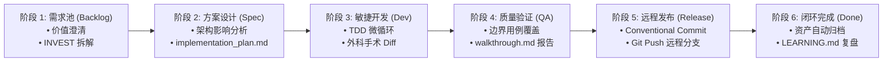

# 敏捷研发端到端标准流程与看板流转规约 (Agile Development Lifecycle & Kanban SOP)

## 1. 敏捷研发全景阶段流水线 (End-to-End Pipeline)

本规范定义了标准敏捷迭代从**需求产生、方案设计、编码自测、QA验证、灰度发布到复盘观测**的 6 阶段闭环流程：

---

## 2. 各阶段执行活动、准入 (DoR) 与准出 (DoD) 标准

| 阶段 | 核心执行活动与角色 | 准入条件 (Definition of Ready / DoR) | 准出条件 (Definition of Done / DoD) |
| :--- | :--- | :--- | :--- |
| **1. 需求池 (Backlog)** | • 业务价值论证 (PM) • User Story 拆解 (INVEST) • 优先级评估 (RICE/MoSCoW) | • 痛点与目标客群明确 • 有清晰的商业/技术价值度量 | • 输出 Gherkin 格式验收标准 (AC) • 需求颗粒度可在一个迭代内交付 |
| **2. 方案设计 (Spec Design)** | • 架构拓扑与影响面评估 (架构师) • 数据库 Schema / 接口设计 • 编写 `implementation_plan.md` | • 需求 PRD 与 AC 已对齐锁定 | • 方案经评审通过并落盘 • 明确 Spec Deltas (`[Added]`, `[Modified]`) • 子任务拆解至 `task.md` |
| **3. 敏捷开发 (In Dev)** | • 外科手术式代码修改 (开发) • TDD 约束协议 (红-绿微循环) • 单元测试与本地构建通过 | • `implementation_plan.md` 已评审就绪 • 本地分支从最新主干拉出 | • 100% 完整生产级代码（零占位符） • 核心业务逻辑单测覆盖率达标 • 本地 lint / build 0 错误 |
| **4. 质量验证 (QA Testing)** | • 极端边界用例验证 (QA/开发) • 接口集成测试与 Mock 隔离 • 整理 `walkthrough.md` 验证报告 | • 开发自测通过，提测分支就绪 • 冒烟测试用例全量通过 | • 验收标准 (AC) 100% 验证通过 • 无 Blocker / Critical 级别缺陷 • 输出完整改动与测试运行证据 |
| **5. 远程发布 (Git Push Release)** | • 遵循 Conventional Commits 原子提交 • `git push` 代码至远程主干/发布分支 • 触发远程 CI/CD 自动化构建 | • 质量验证阶段 100% 验收通过 • 本地工作区无未跟踪/未提交冲突 | • 代码成功 Push 至远程仓库 • 远程 CI 流水线触发通过 |
| **6. 闭环归档 (Done & Review)** | • 过程资产全自动归档 (Archive) • 踩坑教训反哺 `LEARNING.md` • 迭代复盘与总结 (Retrospective) | • 代码已成功合并并 Push 到远程分支 | • 执行 `./automation-tools/archive-specs.sh` • 沉淀 ADR 或架构规范到知识库 |

---

## 3. 看板流转规则 (Kanban Flow Rules)

1. **WIP 限制 (Work In Progress Limit)**：
   - 处于「💻 敏捷开发」和「🧪 质量验证」阶段的任务总数不得超过开发人员数量的 1.5 倍，防止多任务并发切换导致交付阻塞。
2. **阻断与阻塞流转 (Blocked Card)**：
   - 任何任务若遭遇外部依赖未就绪、需求不明确或高危缺陷，必须打上 `[Blocked]` 标记，并注明阻塞原因与推进人。
3. **不可逆流转原则**：
   - 严禁未经前序阶段 DoD 校验跨阶段跳跃流转（例如直接从需求池跨过方案设计直接拖入开发）。
