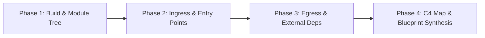
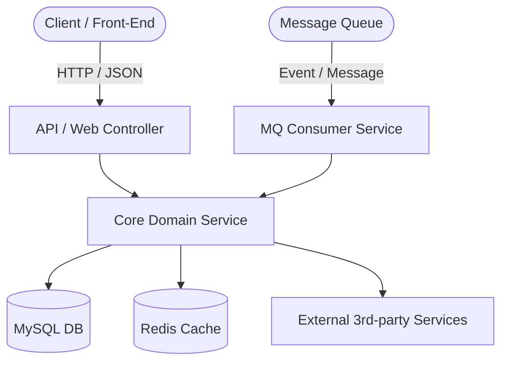

# Macro Architecture Cartographer

## Overview
**Macro Architecture Cartographer** is an agentic analysis skill for constructing high-level architectural blueprints (C4 Context & Container level, component topology, layer boundaries, entry points, and external dependencies) of medium-to-large codebases without getting lost in trivial implementation details.

---

## When to Use
- **New Project Onboarding**: First time exploring a complex repository.
- **Refactoring Planning**: Before proposing architectural refactoring, module decoupling, or microservice splits.
- **System Architecture Review**: Auditing layer boundaries, circular dependencies, and unexpected cross-module leaks.
- **Disaster Recovery & Risk Assessment**: Identifying single points of failure (SPOF) and mission-critical ingress points.

---

## Analysis Workflow (4-Phase Pipeline)



### Phase 1: Build System & Module Hierarchy
1. Identify the build tool (`pom.xml`, `build.gradle`, `package.json`, `go.mod`, `Cargo.toml`).
2. Map module inheritance and multi-module dependencies:
   - Java Maven: `mvn dependency:tree -Dverbose`
   - Gradle: `./gradlew projects` / `./gradlew dependencies`
   - Node: `npm ls --depth=1` / `pnpm list`
   - Go: `go list -m all`
3. Classify modules by architectural roles:
   - `core` / `domain`: Pure business rules, entities, domain services.
   - `api` / `controller` / `transport`: Inbound protocol adapters (HTTP, gRPC, MQ).
   - `infrastructure` / `dao` / `repository`: Outbound storage/external service adapters.
   - `common` / `utils`: Shared utilities, constants, base types.

### Phase 2: Ingress & Entry Point Scanning
Extract and categorize all external trigger points:

| Type | Java (Spring/Dubbo) Pattern | Go / Node / Python Pattern |
| :--- | :--- | :--- |
| **HTTP / REST** | `@RestController`, `@RequestMapping`, `@GetMapping` | `gin.Engine`, `express()`, `@Controller()` |
| **RPC / gRPC** | `@DubboService`, `@GrpcService`, `.proto` files | `pb.Register*Server`, `grpc.NewServer` |
| **MQ Consumer** | `@RabbitListener`, `@KafkaListener`, `@RocketMQMessageListener` | `sarama.Consumer`, `amqp.Consume` |
| **Cron / Jobs** | `@Scheduled`, `@XxlJob`, `@QuartzJob` | `cron.New()`, `celery.task` |

### Phase 3: Egress & Infrastructure Dependency Mapping
Extract all outbound interactions:
1. **Databases**: MyBatis Mappers (`@Mapper`), JPA Repositories (`JpaRepository`), SQL migration scripts (`flyway`, `liquibase`).
2. **Caches & Storage**: Redis (`RedisTemplate`, `@Cacheable`), Memcached, S3/OSS clients.
3. **Message Brokers**: Kafka / RocketMQ / RabbitMQ producers.
4. **External 3rd-Party APIs**: Feign clients (`@FeignClient`), WebClient, RestTemplate, HTTP clients.

### Phase 4: Blueprint Synthesis & Visualization
Assemble findings into standardized Markdown sections with Mermaid diagrams.

---

## Standard Output Template

```markdown
# [Project Name] Macro Architecture Blueprint

## 1. Executive Summary & Tech Stack
- **Architecture Style**: [Monolith / Modular Monolith / Microservices / Event-Driven]
- **Primary Language & Framework**: [e.g., Java 17 + Spring Boot 3 + MyBatis-Plus]
- **Storage & Middleware**: [MySQL 8.0, Redis, RocketMQ, Elasticsearch]

## 2. System Context & Container Map (Mermaid C4)


## 3. Module & Package Decomposition
| Module / Package | Primary Responsibility | Key Interfaces / Classes | Inbound / Outbound Deps |
| :--- | :--- | :--- | :--- |
| `module-api` | Inbound REST endpoints | `*Controller` | Web -> Service |
| `module-service` | Core business logic | `*Service`, `*ServiceImpl` | Core -> Repository |
| `module-infra` | DB & MQ integrations | `*Repository`, `*Mapper` | Service -> DB/MQ |

## 4. Ingress Catalog (Entry Points)
- **REST Endpoints**: [List root paths e.g., `/api/v1/alert/**`]
- **Message Consumers**: [List topics/exchanges subscribed]
- **Scheduled Jobs**: [List job handlers & execution cron]

## 5. Architectural Risks & Hotspots (For Refactoring)
- [ ] Circular dependency detected between `Module A` and `Module B`
- [ ] Direct DB access bypassing service layer found in `*Controller`
- [ ] Missing unified exception handling / API response encapsulation
```

---

## Best Practices & Pitfalls
- **Avoid Token Exhaustion**: Do NOT read whole method bodies during macro analysis. Focus exclusively on class declarations, package structures, annotations, and interface definitions.
- **Look for Hidden Coupling**: Watch out for reflection, event buses (`EventPublisher`), or dynamic RPC calls that do not appear in direct static imports.
- **Preserve Living Artifacts**: Save generated architecture blueprints to `docs/architecture/overview.md` or `GEMINI.md` for team onboarding.
