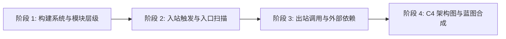
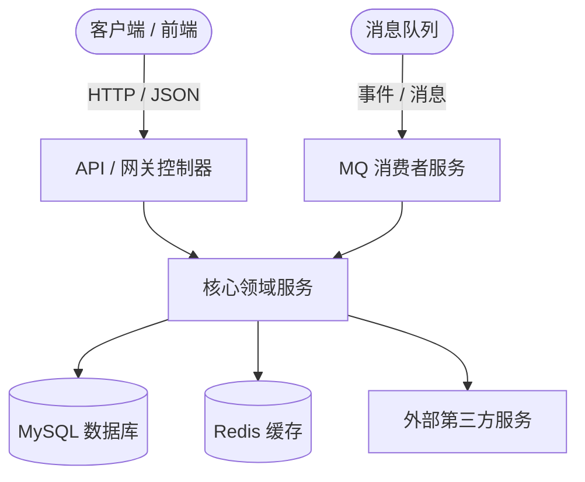

# 宏观架构制图师 (Macro Architecture Cartographer)

## 概述
**宏观架构制图师** 是一套专为中大型代码库设计的 Agent 架构分析技能。它能够在不陷入具体底层实现细节的前提下，快速构建系统级宏观架构蓝图（C4 Context 与 Container 视图、组件拓扑、分层边界、流量入口与外部依赖）。

---

## 适用场景
- **新项目上手 (Onboarding)**：首次探索陌生或复杂的业务仓库。
- **重构方案规划 (Refactoring)**：在提出架构重构、模块解耦或微服务拆分之前梳理全局全貌。
- **系统架构审计 (Architecture Review)**：审查模块分层边界、循环依赖与跨层越权调用。
- **容灾与风险评估 (Risk Assessment)**：识别系统单点故障 (SPOF) 与关键流量入口。

---

## 四阶段分析流水线 (4-Phase Pipeline)



### 阶段 1：构建系统与模块层级 (Build System & Module Hierarchy)
1. 识别项目构建工具与配置文件（`pom.xml`, `build.gradle`, `package.json`, `go.mod`, `Cargo.toml`）。
2. 分析模块继承关系与多模块依赖拓扑：
   - Java Maven: `mvn dependency:tree -Dverbose`
   - Gradle: `./gradlew projects` / `./gradlew dependencies`
   - Node: `npm ls --depth=1` / `pnpm list`
   - Go: `go list -m all`
3. 按照架构职责归类各模块：
   - `core` / `domain`：纯业务领域规则、实体与领域服务。
   - `api` / `controller` / `transport`：入站协议适配层（HTTP, gRPC, MQ）。
   - `infrastructure` / `dao` / `repository`：出站持久化与外部服务适配层。
   - `common` / `utils`：共享基础工具类、常量与通用类型。

### 阶段 2：入站触发与入口扫描 (Ingress & Entry Point Scanning)
提取并归类所有外部请求或触发源：

| 类型 | Java (Spring/Dubbo) 特征 | Go / Node / Python 特征 |
| :--- | :--- | :--- |
| **HTTP / REST** | `@RestController`, `@RequestMapping`, `@GetMapping` | `gin.Engine`, `express()`, `@Controller()` |
| **RPC / gRPC** | `@DubboService`, `@GrpcService`, `.proto` 定义 | `pb.Register*Server`, `grpc.NewServer` |
| **MQ 消费者** | `@RabbitListener`, `@KafkaListener`, `@RocketMQMessageListener` | `sarama.Consumer`, `amqp.Consume` |
| **定时任务** | `@Scheduled`, `@XxlJob`, `@QuartzJob` | `cron.New()`, `celery.task` |

### 阶段 3：出站调用与外部基础设施依赖 (Egress & Infrastructure Mapping)
梳理所有向外交互的出站依赖：
1. **数据库存储**：MyBatis Mapper (`@Mapper`), JPA Repositories (`JpaRepository`), SQL 迁移脚本 (`flyway`, `liquibase`)。
2. **缓存与对象存储**：Redis (`RedisTemplate`, `@Cacheable`), Memcached, S3/OSS 客户端。
3. **消息队列生产者**：Kafka / RocketMQ / RabbitMQ Producer。
4. **外部第三方 API**：Feign 客户端 (`@FeignClient`), WebClient, RestTemplate, HTTP Client。

### 阶段 4：架构蓝图合成与可视化 (Blueprint Synthesis & Visualization)
将分析结果整理为标准 Markdown 文档，配合 Mermaid 架构图呈现。

---

## 标准输出蓝图模板 (Standard Output Template)

```markdown
# [项目名称] 宏观架构蓝图

## 1. 概览摘要与技术栈
- **架构风格**: [单体 / 模块化单体 / 微服务 / 事件驱动]
- **主语言与框架**: [例如：Java 17 + Spring Boot 3 + MyBatis-Plus]
- **存储与中间件**: [MySQL 8.0, Redis, RocketMQ, Elasticsearch]

## 2. 系统上下文与容器拓扑 (Mermaid C4)


## 3. 模块与包分层拆解
| 模块 / 路径 | 核心职责 | 关键接口 / 类 | 上下游依赖关系 |
| :--- | :--- | :--- | :--- |
| `module-api` | 入站 REST 控制器 | `*Controller` | Web -> Service |
| `module-service` | 核心业务逻辑 | `*Service`, `*ServiceImpl` | Core -> Repository |
| `module-infra` | 数据库与 MQ 集成 | `*Repository`, `*Mapper` | Service -> DB/MQ |

## 4. 流量入口清单 (Ingress Catalog)
- **REST 端点**: [列出主要根路径，如 `/api/v1/alert/**`]
- **消息消费者**: [列出订阅的 Topic / Exchange]
- **定时调度任务**: [列出 Job Handler 及 Cron 表达式]

## 5. 架构风险与重构关注点 (Risks & Hotspots)
- [ ] 检测到 `模块 A` 与 `模块 B` 之间存在循环依赖
- [ ] 发现 `*Controller` 存在越权绕过 Service 层直接操作数据库
- [ ] 缺少统一全局异常处理 / API 响应未统一封装
```

---

## 最佳实践与避坑指南
- **避免 Token 耗尽**：进行宏观分析时，**严禁**通读完整函数体，只精读类声明、包结构、注解与接口定义。
- **识别隐式耦合**：重点注意通过反射、事件总线 (`EventPublisher`) 或动态 RPC 分发的调用，此类调用不会出现在常规的静态 import 中。
- **资产留存沉淀**：将生成的架构蓝图归档保存至 `docs/architecture/overview.md` 或沉淀在本地 `GEMINI.md` 中，作为团队共享知识资产。
