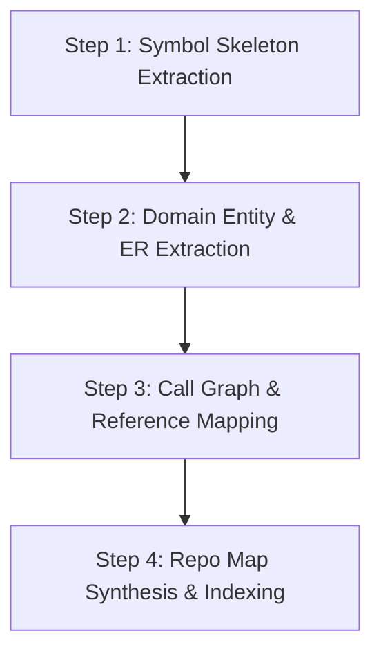
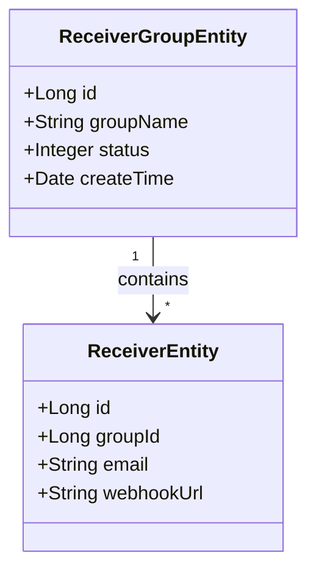

# Repo Map Analyzer

## Overview
**Repo Map Analyzer** is a high-precision, token-efficient code structure analysis skill. It parses a repository's AST (Abstract Syntax Tree) to extract symbol skeletons (interfaces, classes, methods, fields, entities), cross-file relationships, and domain models, enabling deep structural understanding with minimal context window overhead.

---

## When to Use
- **Deep Exploration**: When you need to understand specific module internals without reading hundreds of raw implementation lines.
- **Domain Modeling**: Extracting core business entities, value objects, and database relationships (ER diagrams).
- **Refactoring Blast Radius**: Tracing upstream callers and downstream dependencies of specific methods or classes.
- **AI Context Compression**: Generating compact symbol skeletons to feed into planning prompts or `GEMINI.md`.

---

## Analysis Pipeline (4-Step Flow)



### Step 1: Symbol Skeleton Extraction
Extract signatures and contract definitions while discarding method implementation bodies:
- **Interfaces & Abstract Classes**: Public method signatures, generic parameters, return types.
- **Service Interfaces**: Core business contract methods.
- **DTOs / VO / Command Objects**: Key field names, data types, validation annotations (`@NotNull`, `@Valid`).

#### Fast Shell / Ripgrep Recipes
```bash
# Java: Extract all Interface and Class signatures
rg --no-heading --line-number 'public (interface|class|enum|record)\s+\w+'

# Java: Extract Service interface methods
rg -A 2 'public interface \w+Service' src/

# Go: Extract struct and interface signatures
rg 'type \w+ (struct|interface)'

# TypeScript / Python: Extract classes and type definitions
rg '^(export )?(class|interface|type) \w+'
```

---

### Step 2: Domain Entity & ER Modeling
Identify aggregate roots, entities, and database mappings:
1. Scan for ORM annotations:
   - Java / MyBatis / JPA: `@TableName`, `@Entity`, `@Table`, `@Id`
   - Go (GORM): `gorm.Model`, `gorm:"..."`
   - Python / Django / SQLAlchemy: `models.Model`, `Base`
2. Extract relationships:
   - 1:1, 1:N, N:M associations and foreign key references.
   - Status / Enum state fields and lifecycle transitions.

---

### Step 3: Call Graph & Reference Tracing
Trace interactions across layers:
1. **Entry to Service**: Which Controller actions invoke which Service methods.
2. **Service to DAO/Repo**: Which Service methods query or mutate specific Tables/Mappers.
3. **Cross-Service / Event Triggers**: Where domain events or asynchronous tasks are dispatched.

---

### Step 4: Repo Map Synthesis

Assemble the findings into structured symbol map artifacts:

```markdown
# [Module Name] Repository Symbol Map

## 1. Domain Entities & Value Objects (ER Model)


## 2. Core Service Contracts & API Outline
### `ReceiverGroupService` (`com.rubikstack.alert.service.ReceiverGroupService`)
- `page(ReceiverGroupPageQuery query): PageResult<ReceiverGroupVO>` — 分页查询接收组
- `getById(Long id): ReceiverGroupVO` — 查询接收组详情
- `save(ReceiverGroupVO vo): void` — 新增接收组
- `update(ReceiverGroupVO vo): void` — 更新接收组配置
- `deleteByIds(List<Long> ids): void` — 批量删除接收组

## 3. Layer Call Graph
`ReceiverGroupController` (REST)
 └── `ReceiverGroupRepository` / `ReceiverGroupService`
      ├── `ReceiverGroupMapper` (MyBatis -> `alert_receiver_group`)
      └── `ReceiverMapper` (MyBatis -> `alert_receiver`)
```

---

## Token Efficiency Best Practices
1. **Never read whole files for discovery**: Always grep / query method signatures first.
2. **Compress boilerplate**: Omit standard getters/setters, `equals()`, and `hashCode()` methods.
3. **Annotate key semantics**: Always retain transactional boundaries (`@Transactional`), caching (`@Cacheable`), and security annotations (`@PreAuthorize`).
