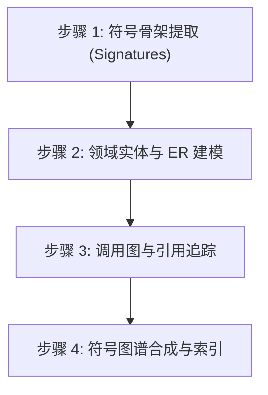
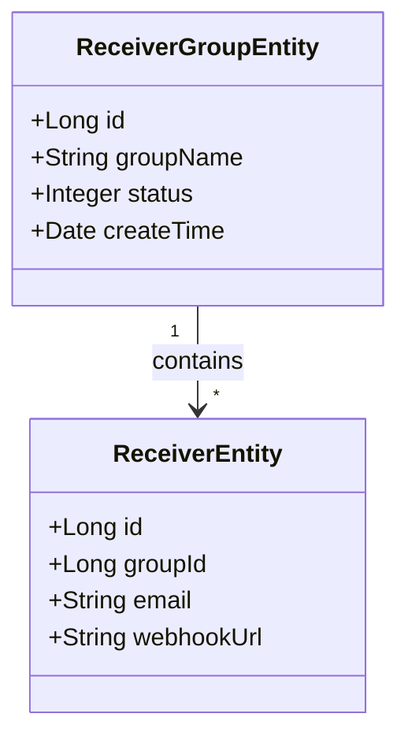

# 代码仓库符号图谱分析师 (Repo Map Analyzer)

## 概述
**代码仓库符号图谱分析师** 是一套高精度、极度节省 Token 的代码结构分析技能。它通过解析代码抽象语法树（AST），提取符号骨架（接口、类、方法签名、字段、实体声明）、跨文件依赖与领域模型，以极小的上下文开销实现对代码库的纵深理解。

---

## 适用场景
- **局部深度探索 (Deep Exploration)**：在无需读取成百上千行具体业务实现的前提下，快速掌握指定模块的内部设计。
- **领域建模 (Domain Modeling)**：提取核心业务实体、值对象及数据库关系模型（ER 关系图）。
- **重构影响面评估 (Refactoring Blast Radius)**：逆向追踪关键方法或类的上下游调用链与修改影响范围。
- **AI 上下文压缩 (Context Compression)**：生成紧凑的符号骨架，作为输入注入到 `implementation_plan.md` 或 `GEMINI.md` 中。

---

## 四步分析流水线 (4-Step Flow)



### 步骤 1：符号骨架提取 (Symbol Skeleton Extraction)
仅提取方法签名、接口契约与类型声明，主动忽略具体的函数体实现：
- **接口与抽象类**：公有方法签名、泛型参数、返回值类型。
- **服务契约接口 (Service Interfaces)**：核心业务契约方法定义。
- **DTO / VO / 入参对象**：核心属性字段、类型、校验注解（如 `@NotNull`, `@Valid`）。

#### 常用高效 Ripgrep 提取命令
```bash
# Java: 提取所有 Interface、Class、Record 声明
rg --no-heading --line-number 'public (interface|class|enum|record)\s+\w+'

# Java: 提取 Service 接口核心方法
rg -A 2 'public interface \w+Service' src/

# Go: 提取 Struct 与 Interface 签名
rg 'type \w+ (struct|interface)'

# TypeScript / Python: 提取 Class 与 Type 定义
rg '^(export )?(class|interface|type) \w+'
```

---

### 步骤 2：领域实体与 ER 建模 (Domain Entity & ER Modeling)
识别聚合根、实体对象与数据库表映射关系：
1. **扫描 ORM 注解**：
   - Java / MyBatis / JPA: `@TableName`, `@Entity`, `@Table`, `@Id`
   - Go (GORM): `gorm.Model`, `gorm:"..."`
   - Python / Django / SQLAlchemy: `models.Model`, `Base`
2. **提取关联关系**：
   - 梳理 1:1、1:N、N:M 关联与外键映射。
   - 提取业务状态枚举字段及其生命周期流转。

---

### 步骤 3：调用图与引用追踪 (Call Graph & Reference Tracing)
追踪跨层交互链路：
1. **入口到服务层 (Entry -> Service)**：哪些 Controller / Handler 动作调用了哪个 Service 方法。
2. **服务层到持久层 (Service -> DAO/Repo)**：哪些 Service 方法查询或操作了具体的表与 Mapper。
3. **跨服务与异步事件**：在哪些位置触发了领域事件（Domain Event）或 MQ 消息派发。

---

### 步骤 4：符号图谱合成 (Repo Map Synthesis)

将分析提炼的结果整合成结构化的符号地图文档：

```markdown
# [模块名称] 核心符号与关系图谱

## 1. 领域实体与值对象模型 (ER Model)


## 2. 核心服务契约与 API 大纲
### `ReceiverGroupService` (`com.rubikstack.alert.service.ReceiverGroupService`)
- `page(ReceiverGroupPageQuery query): PageResult<ReceiverGroupVO>` — 分页查询接收组
- `getById(Long id): ReceiverGroupVO` — 查询接收组详情
- `save(ReceiverGroupVO vo): void` — 新增接收组
- `update(ReceiverGroupVO vo): void` — 更新接收组配置
- `deleteByIds(List<Long> ids): void` — 批量删除接收组

## 3. 分层调用链 (Call Graph)
`ReceiverGroupController` (REST API)
 └── `ReceiverGroupRepository` / `ReceiverGroupService`
      ├── `ReceiverGroupMapper` (MyBatis -> `alert_receiver_group`)
      └── `ReceiverMapper` (MyBatis -> `alert_receiver`)
```

---

## Token 效能最佳实践
1. **严禁盲目整文件通读**：在探索和定位时，始终先用 `grep_search` / `rg` 检索方法签名。
2. **压缩样板代码**：主动忽略标准的 Getter/Setter、`equals()`、`hashCode()` 等模板方法。
3. **保留核心语义注解**：在提取符号时，务必保留事务边界（`@Transactional`）、缓存标记（`@Cacheable`）和鉴权注解（`@PreAuthorize`）。
